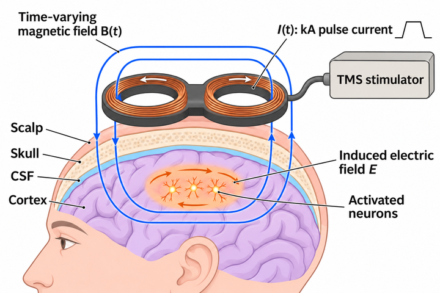
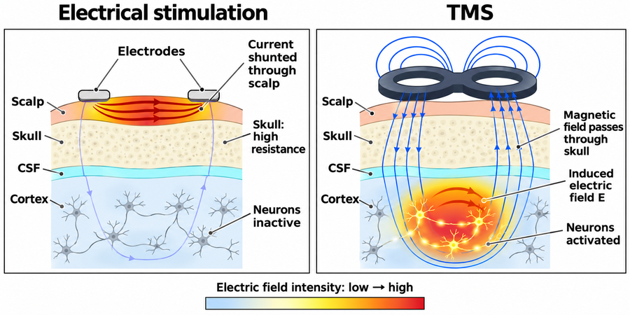
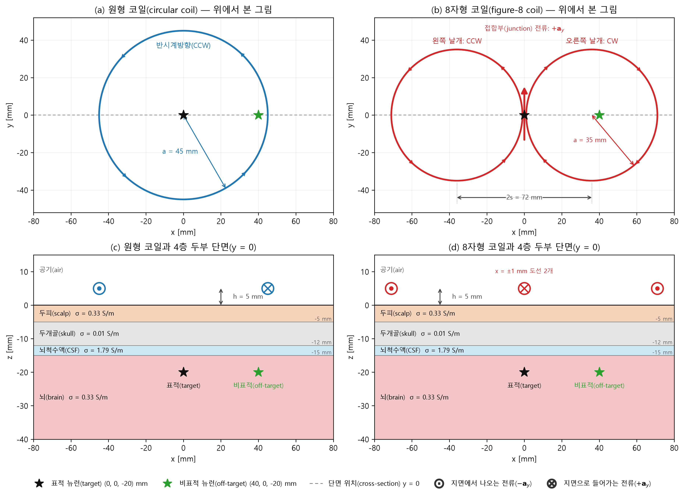
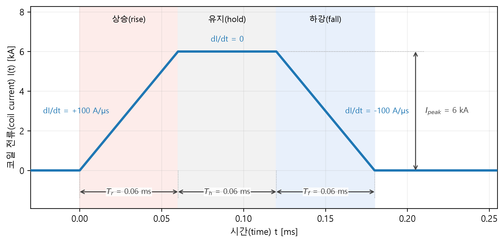
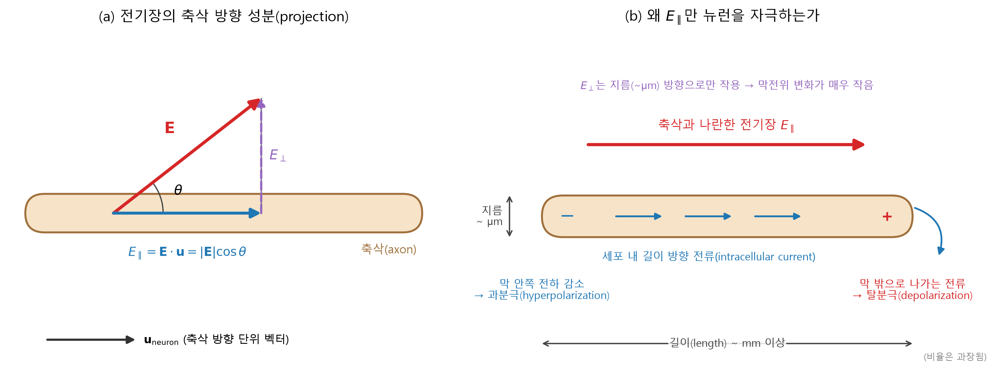

# 경두개 자기 자극(Transcranial Magnetic Stimulation, TMS)의 전자기장 모델링

**EEC2204 전자기학 2 | 텀 프로젝트(TERM PROJECT)**  
인하대학교 전기전자공학부 | 담당교수: 이지호 | 총점: 100점

---

## 1. Overview

경두개자기자극(Transcranial Magnetic Stimulation, TMS)은 코일(coil)에 kA 크기 펄스 전류(pulsed current) $I(t)$를 흘려 생성된 시변 자기장(time-varying magnetic field)으로 비침습적으로 뇌의 뉴런 세포를 자극하는 뇌질환 치료 의료기술임.

**그림 1.** 경두개자기자극(TMS)의 원리. 코일에 펄스 전류 $I(t)$가 흐를 때 시변 자기장(파란색 폐곡선)이 피질에 전기장(주황색 화살표)을 유도함. 빛나는 뉴런은 유도 전기장에 반응해 활성화된 뉴런을 나타냄.

두피에 직접적으로 전류를 흐르게 하는 전기자극(electrical stimulation)은 전기전도도(electrical conductivity, $\sigma$)가 낮고 저항이 큰 두개골(skull, $\sigma = 0.010\ \text{S/m}$) 때문에 뉴런에 흐르는 전류가 매우 작지만, TMS 코일에서 생성된 자기장 $\mathbf{H}$는 인체 조직이 대부분 진공과 유사한 투자율($\mu$; $\mu_0 = 4\pi\times10^{-7}\ \text{H/m}$)을 가지기 때문에 두개골을 쉽게 통과하여 대뇌 피질에 유도 전기장(induced electric field) $\mathbf{E}$를 형성하고 뉴런에 활동전위(action potential) 생성하기 충분한 전류를 흐르게 함.

**그림 2.** 두피 전기자극(왼쪽)과 TMS(오른쪽)의 전기장 분포 예시. 두 패널의 공통 색상표는 전기장 세기를 정성적으로 나타냄(옅은 파란색에서 노란색·빨간색으로 갈수록 강함). 오른쪽의 진한 파란색 선은 자기장선이며, 빛나는 뉴런은 이 예시에서 활성화된 뉴런을 나타냄.

본 과제의 목표는 다음과 같음: 전자기장 시뮬레이션을 통해 TMS 코일에서 생성되는 자기장 $\mathbf{H}$와 대뇌 피질(cortex)에 유도되는 전기장 $\mathbf{E}$를 분석하고, 호지킨-헉슬리(Hodgkin-Huxley) 뉴런 모델을 이용해 $\mathbf{E}$에 의한 활동전위 생성을 관찰함. 또한, 서로 다른 코일 디자인에 따라 상기 효과 차이를 종합 비교함.

## 2. Physical Condition & Simulation Configuration

본 절의 물리 상수와 코일·펄스·조직 매개변수는 모두 `starter_code/tms_config.py`에 정의되어 있으므로, 코드 작성 시 이 파일을 참고함.

### 2.1 물리 조건: 자기 준정역학(Magneto-Quasi-Static, MQS) 근사

TMS 코일과 두부 내부의 전자기장은 다음 맥스웰 방정식(Maxwell's equations)을 따름.

$$
\nabla\times\mathbf{E} = -\frac{\partial\mathbf{B}}{\partial t}, \qquad
\nabla\times\mathbf{H} = \mathbf{J} + \frac{\partial\mathbf{D}}{\partial t}, \qquad
\nabla\cdot\mathbf{B} = 0, \qquad
\nabla\cdot\mathbf{D} = \rho_v
$$

인체 조직은 비자성체(non-magnetic material)이므로 $\mathbf{B} = \mu_0\mathbf{H}$이고, 조직 내부에서는 $\mathbf{J} = \sigma\mathbf{E}$, $\mathbf{D} = \epsilon\mathbf{E}$임. 사다리꼴 펄스의 상승·하강 시간이 $T_r = T_f = 0.06\ \text{ms}$이므로 주요 주파수 성분은 $f \sim 10\ \text{kHz}$ 수준이며, 이 주파수에서 다음 세 조건이 성립하여 자기 준정역학(MQS) 근사를 사용할 수 있음.

1. **변위 전류(displacement current) 무시:** 조직의 비유전율(relative permittivity)이 $\epsilon_r \sim 10^4$ 정도로 커도 $\omega\epsilon/\sigma \approx 0.02 \ll 1$이므로, $\partial\mathbf{D}/\partial t$를 전도 전류(conduction current) $\sigma\mathbf{E}$에 비해 무시함.
2. **전파(propagation) 효과 무시:** 자유공간 파장 $\lambda = c/f \approx 30\ \text{km}$가 두부 크기($\sim 0.2\ \text{m}$)보다 훨씬 크므로, 지연(retardation) 없이 코일 전류가 변하는 순간 공간 전체의 장이 함께 변함.
3. **와전류의 2차 자기장 무시:** 침투 깊이(skin depth) $\delta = \sqrt{2/(\omega\mu_0\sigma)}$가 두피·뇌 약 $8.8\ \text{m}$, 뇌척수액(CSF) 약 $3.8\ \text{m}$로 두부 크기보다 훨씬 크므로, 조직 내 와전류(eddy current)가 만드는 2차 자기장(secondary magnetic field)은 코일 자기장에 비해 무시함.

따라서 자기장은 코일 전류 $I(t)$만으로 결정되며, 공간 분포는 고정되고 시간 변화는 전류 파형을 그대로 따름.

$$
\nabla\times\mathbf{H} = \mathbf{J}_{\text{coil}}, \qquad \nabla\cdot\mathbf{B} = 0
\quad\Longrightarrow\quad
\mathbf{B}(\mathbf{r}, t) = I(t)\,\tilde{\mathbf{B}}(\mathbf{r})
$$

**퍼텐셜 표현(potential formulation):** $\nabla\cdot\mathbf{B} = 0$이므로 $\mathbf{B} = \nabla\times\mathbf{A}$로 쓸 수 있으며, $N$회 감긴 코일 전류가 만드는 벡터 자기 퍼텐셜(magnetic vector potential)은 다음과 같음.

$$
\mathbf{A}(\mathbf{r}, t) = \frac{\mu_0 N I(t)}{4\pi}\oint_{\text{coil}}\frac{d\mathbf{l}'}{|\mathbf{r} - \mathbf{r}'|} = I(t)\,\tilde{\mathbf{A}}(\mathbf{r})
$$

이를 패러데이 법칙(Faraday's law)에 대입하면 $\nabla\times(\mathbf{E} + \partial\mathbf{A}/\partial t) = 0$이므로, 전기장은 스칼라 전위(scalar potential) $V$를 사용해 다음과 같이 표현됨.

$$
\mathbf{E}(\mathbf{r}, t) = -\frac{\partial\mathbf{A}}{\partial t} - \nabla V = -\tilde{\mathbf{A}}(\mathbf{r})\,\frac{dI}{dt} - \nabla V
$$

- $-\partial\mathbf{A}/\partial t$: 코일 전류의 시간 변화가 직접 만드는 1차 유도 전기장(primary induced field). 공간 분포는 $\tilde{\mathbf{A}}(\mathbf{r})$, 시간 변화는 $dI/dt$로 정해짐.
- $-\nabla V$: 유도 전류가 전기전도도가 다른 경계면(공기–두피, 조직 층 사이)에 쌓는 표면 전하(surface charge)가 만드는 2차 전기장(secondary field). $V$는 준정적 연속 방정식(quasi-static continuity equation) $\nabla\cdot\mathbf{J} = \nabla\cdot\left[\sigma\left(-\partial\mathbf{A}/\partial t - \nabla V\right)\right] = 0$과 경계 조건으로 결정됨.

수평 코일과 평면 4층 두부에서 $\nabla V$가 어떻게 되는지는 Task 2.1에서 증명함.

### 2.2 시뮬레이션 구성(Simulation Configuration)

공기–두피(air–scalp) 경계면을 $z = 0$으로 두는 직교좌표계(Cartesian coordinates)를 사용하며, $z > 0$ 영역은 공기, $z \le 0$ 영역은 4개의 수평 조직 층(tissue layer)임. TMS 코일은 원형 코일(circular coil) 또는 8자형 코일(figure-8 coil)을 고려하며, $z = +h$ 평면에 수평으로 배치하고 코일의 두께는 고려하지 않음. 대뇌 피질의 표적(target) 뉴런은 8자형 코일 중심 아래 $\mathbf{r}_{\text{target}} = (0, 0, -20\ \text{mm})$에, 비표적(off-target) 뉴런은 측방 $\mathbf{r}_{\text{off}} = (40\ \text{mm}, 0, -20\ \text{mm})$에 위치하며, 두 뉴런 모두 축삭 단위 벡터(axon unit vector) $\mathbf{u}_{\text{neuron}} = -\mathbf{a}_y$ 방향으로 정렬됨. 뉴런은 유도 전기장 중 축삭 방향 성분에 반응하며, 축삭 방향과 전기장의 관계는 Task 3의 배경 설명(그림 5)을 참고함.

**그림 3.** 코일과 4층 두부 모델 형상. (a), (b) 원형 코일과 8자형 코일을 위에서 본 그림으로, 화살표는 전류 방향임. 8자형 코일은 중앙 접합부에서 두 날개의 전류가 모두 $+\mathbf{a}_y$ 방향이 되도록 왼쪽 날개를 반시계방향(CCW), 오른쪽 날개를 시계방향(CW)으로 감음. (c), (d) $y = 0$ 단면에서 본 코일 도선(⊙: 지면에서 나오는 전류, ⊗: 지면으로 들어가는 전류)과 4층 두부, 표적/비표적 뉴런 위치.

| 공간/도형 변수                 | 값                                      | 물리적 의미                                                                                                                                                               |
| :------------------------: | :--------------------------------------: | :--------------------------------------------------------------------------------------------------------------------------------------------------------------------: |
| 코일 권선 및 격자 (공간 분할 단위) | $N = 10$ $K = 180$ $r_w = 1.5$   | $N$: 코일 권선 수 \[turns\] $K$: 루프당 선분(segment) 분할 수 $r_w$: 도선 반경(wire radius) \[mm\]                                                                              |
| 원형 코일(Circular Coil)     | $a_{circ} = 45$ $h = 5$             | $a_{circ}$: 코일 반지름 \[mm\] $h$: 코일 중심의 z 좌표 \[mm\]                                                                                                                 |
| 8자형 코일(Figure-8 Coil)    | $a_{fig8} = 35$ $s = 36$ $h = 5$ | $a_{fig8}$: 코일 반지름 \[mm\] $s$: 코일 중심의 x 좌표 \[mm\] $h$: 코일 중심의 z 좌표 \[mm\] \* 반시계방향 전류가 흐르는 코일의 중심 좌표 $(-s, 0, +h)$, 시계방향 전류가 흐르는 코일의 중심 좌표 $(+s, 0, +h)$ |

| 회로 변수 | 값                                        | 물리적 의미                                                                                                                            |
| :-----: | :----------------------------------------: | :---------------------------------------------------------------------------------------------------------------------------------: |
| 코일 전류 | $I_{peak} = 6$ $T_r, T_h, T_f = 0.06$ | $I_{peak}$: 최대 코일 전류 \[kA\] $T_r, T_h, T_f$: 상승(rise), 유지(hold), 하강(fall) 시간 \[ms\] \* 상승/하강 구간의 전류 변화율은 $\pm 100$ \[A/μs\] |

**그림 4.** 사다리꼴 코일 전류(trapezoidal coil current) $I(t)$ 파형. 상승(rise) 구간에서 $0.06\ \text{ms}$ 동안 $6\ \text{kA}$까지 선형으로 증가하고($dI/dt = +100\ \text{A/μs}$), 유지(hold) 구간에서 일정하게 유지된 뒤($dI/dt = 0$), 하강(fall) 구간에서 선형으로 감소함($dI/dt = -100\ \text{A/μs}$).

| 조직                     | 두께 \[mm\]          | 전기전도도 $\sigma$ \[S/m\] |
| :----------------------: | :------------------: | :----------------------: |
| 두피(Skin / Scalp)       | $5.0$              | $0.33$                 |
| 두개골(Skull / Bone)      | $7.0$              | $0.01$                 |
| 뇌척수액(CSF)              | $3.0$              | $1.79$                 |
| 뇌/대뇌피질(Brain / Cortex) | $\sim\infty$ (50+) | $0.33$                 |

---

## 3. Problems (90 + 10점)

각 Task는 `starter_code/`의 대응 파일 하나에서 구현함. 파일을 직접 실행하면(예: `python task1_coil_field.py`) 해당 Task의 검증 값이 출력됨. 아래에는 각 함수의 기능만 설명하며, 인자(argument)와 입출력(input/output) 형식은 Python 파일의 docstring에 적혀 있음. 공통 상수, 펄스 매개변수, 두부 모델은 `tms_config.py`(수정 금지)에 정의되어 있으며, Task 2와 Task 3은 Task 1의 함수를 불러 쓰므로 Task 1을 먼저 완성하라.

| Task   | 구현 파일                       | 구현할 함수                                                                                                                                                                            |
| ------ | --------------------------- | --------------------------------------------------------------------------------------------------------------------------------------------------------------------------------- |
| Task 1 | `task1_coil_field.py`       | `make_circular_loop`, `build_figure8_coil`, `compute_unit_A_and_B`, `analytical_circular_on_axis_Bz`, `verify_curl_A`, `trapezoidal_pulse_current_and_didt`, `compute_inductance` |
| Task 2 | `task2_tissue_induction.py` | `compute_depth_profile`, `compute_target_waveforms`, `compute_cortical_metrics`, `sweep_wing_radius`, `sweep_standoff`, `sweep_lateral_offset`                                    |
| Task 3 | `task3_neuron.py`           | `compute_E_eff_waveform`, `compute_fig8_thresholds`, `find_max_standoff`                                                                                                          |

---

### Task 1 — 코일 자기장과 인덕턴스 (30점)

구현 파일: `task1_coil_field.py`

#### Task 1.1 — 중심축 $B_z$ 해석해와 수치해 비교 (15점)

손으로 유도한 원형 코일의 중심축 $B_z$ 해석해와 비오-사바르(Biot–Savart) 수치해를 비교하여 코일 모델이 정확한지 검증함.

**구현할 함수:**

- `make_circular_loop`: 수평 원형 루프(circular loop)를 $K$개의 직선 선분(segment)으로 나누어 각 선분의 중점 위치와 방향 벡터(chord vector)를 만듦. 감는 방향(반시계/시계)을 지정할 수 있음.
- `build_figure8_coil`: 원형 루프 두 개를 좌우에 배치해 8자형 코일(figure-8 coil)을 만듦. 중앙 접합부(junction)에서 두 날개(wing)의 전류가 모두 $+\mathbf{a}_y$ 방향이 되도록 왼쪽 날개는 반시계방향(CCW), 오른쪽 날개는 시계방향(CW)으로 감음.
- `compute_unit_A_and_B`: 코일 선분들이 관측점(observation point)에 만드는 단위 전류(unit current, $I = 1\ \text{A}$)당 벡터 퍼텐셜(vector potential) $\tilde{\mathbf{A}}$와 자기선속밀도(magnetic flux density) $\tilde{\mathbf{B}}$를 아래 이산 합(discrete sum)으로 계산함. 실제 장은 전류를 곱해 $\mathbf{A} = I\tilde{\mathbf{A}},\ \mathbf{B} = I\tilde{\mathbf{B}}$로 얻음.
- `analytical_circular_on_axis_Bz`: 손으로 유도한 원형 루프의 중심축(on-axis) $B_z$ 공식을 계산함. 수치해(numerical solution) 검증의 기준값임.
- `verify_curl_A`: 한 점 주변에서 $\tilde{\mathbf{A}}$에 중앙 유한 차분(central finite difference)을 적용해 $\nabla\times\tilde{\mathbf{A}}$를 구하고, $\tilde{\mathbf{B}}$와의 상대오차(relative error)를 계산함.

$$
\tilde{\mathbf{A}}(\mathbf{r}) = \frac{\mu_0 N}{4\pi}\sum_k \frac{d\mathbf{l}_k}{R_k}, \qquad
\tilde{\mathbf{B}}(\mathbf{r}) = \frac{\mu_0 N}{4\pi}\sum_k \frac{d\mathbf{l}_k \times (\mathbf{r} - \mathbf{r}'_k)}{R_k^3}
$$

**수행할 내용:**

1. **해석해 유도:** $(0, 0, +h)$ 중심에 놓인 반경 $a_{\text{circ}}$, $N$회 권선 원형 루프에 전류 $I$가 흐를 때, 중심축 자기선속밀도 $B_z(0, 0, z)$를 비오-사바르 법칙으로부터 **손으로 유도**하여 보고서에 제시하라.
2. **해석해–수치해 비교:** 구간 $z \in [0, -60\ \text{mm}]$에서 수치 $B_z$와 해석해를 한 그래프에 도시하고, 최대 상대오차가 $10^{-4}$ 미만임을 보여라.
3. **회전 항등식 검증:** `verify_curl_A`로 $(45\ \text{mm}, 0, -20\ \text{mm})$ (원형) 및 $(0, 0, -20\ \text{mm})$ (8자형)에서 $\delta = 10^{-5}\ \text{m}$일 때 $\nabla \times \tilde{\mathbf{A}} = \tilde{\mathbf{B}}$임을 확인하라.

#### Task 1.2 — 인덕턴스와 구동 전압 (15점)

벡터 퍼텐셜의 쇄교 자속으로 코일 인덕턴스를 계산하고, 사다리꼴 전류 펄스를 만드는 데 필요한 구동 전압과 저장 에너지를 구함.

**구현할 함수:**

- `trapezoidal_pulse_current_and_didt`: 상승–유지–하강으로 이루어진 사다리꼴 전류 펄스(trapezoidal current pulse) $I(t)$와 그 시간 미분 $dI/dt$를 만듦.
- `compute_inductance`: 두 선분 집합 사이의 쇄교 자속(flux linkage)을 아래 이중합(double sum)으로 계산하여 자기 인덕턴스(self-inductance) $L$ 또는 상호 인덕턴스(mutual inductance) $M_{12}$를 구함. 같은 선분끼리 거리가 $0$이 되어 발산하는 것을 피하도록 세선 기하평균거리(geometric mean distance, GMD) 정칙화(regularization) $d_{\text{eff}} = r_w e^{-1/4}$를 사용하며, $L_1 + L_2 + 2M_{12}$가 $L_{\text{fig8}}$과 정확히 일치하도록 상호 인덕턴스에도 같은 $d_{\text{eff}}$를 적용함.

$$
L\ \text{or}\ M_{12} = \frac{\mu_0 N^2}{4\pi}\sum_{i,j} \frac{d\mathbf{l}_{1,i}\cdot d\mathbf{l}_{2,j}}{\sqrt{|\mathbf{r}_{1,i} - \mathbf{r}_{2,j}|^2 + d_{\text{eff}}^2}}, \qquad
V_{\text{coil}}(t) = L\frac{dI}{dt}, \qquad
W_m = \frac{1}{2}L I_{\text{peak}}^2
$$

**수행할 내용:**

1. 원형 코일의 $L_{\text{circ}}$을 세선 해석 공식 $L \approx \mu_0 N^2 a\left[\ln(8a/r_w) - 1.75\right]$과 비교하라.
2. 8자형 코일 두 날개의 $L_1, L_2$와 상호 인덕턴스 $M_{12}$를 구하고, $M_{12}$ 부호의 물리적 의미를 설명한 뒤, 전체 코일에서 직접 구한 $L_{\text{fig8}}$과 $L_1 + L_2 + 2M_{12}$가 일치함을 보여라.
3. 두 코일의 구동 전압 파형 $V_{\text{coil}}(t)$(양극성 구형파)를 $I(t)$와 함께 도시하고, 최대 저장 자기 에너지 $W_m$을 계산하라.

---

### Task 2 — 조직 레이어에서 유도 전기장 (40점)

구현 파일: `task2_tissue_induction.py`

#### Task 2.1 — 유도 전기장이 전도도와 무관함을 증명 (12점, 보고서만)

불균일 도체 두부에서 준정적 전기장은 $\mathbf{E} = -\nabla V - \partial\mathbf{A}/\partial t$이며, 스칼라 전위 $V$는 전도도 경계면에 쌓이는 표면 전하의 기여임. 4층 평면 두부 위의 수평 코일($\theta = 0^\circ$)에 대해 다음을 제1원리로부터 보여라.

- **(a) 벡터 퍼텐셜의 구조:** 평면 $z' = +h$에 놓인 수평 코일의 $\mathbf{A}$ 적분식을 쓰고, 전 공간에서 $0$인 성분과 $0$이 아닌 성분을 밝혀라. 닫힌 전류 루프에 대해 $\nabla\cdot\mathbf{A}$를 구하라.
- **(b) 층 내부 방정식:** 각 층에서 $\mathbf{J} = \sigma_m(-\nabla V - \partial\mathbf{A}/\partial t)$를 $\nabla\cdot\mathbf{J} = 0$에 대입하여 $V$가 만족하는 편미분방정식을 유도하고, $\mathbf{A}$의 수평 성분이 $V$의 체적 원천항을 만들지 않는 이유를 설명하라.
- **(c) 경계 조건:** 공기–두피 경계($z = 0^-$, $\sigma_{\text{air}} = 0$)와 내부 경계 $z = -5, -12, -15\ \text{mm}$에서 $V$와 $J_z$의 연속성을 적용하고, (a)와 결합해 $V$와 $\partial V/\partial z$에 대한 경계 조건을 유도하라.
- **(d) 유일성:** (b), (c)와 무한원 조건($|\mathbf{r}| \to \infty$에서 $V \to 0$)에 유일성 정리(또는 $\int\sigma|\nabla V|^2\,dv$ 에너지 항등식)를 적용하여 $V$와 $\nabla V$를 구하고, 4개 층 모두에서 성립하는 $\mathbf{E}(\mathbf{r}, t)$를 써라. 전도도가 낮은 두개골($\sigma_2 = 0.010\ \text{S/m}$)이 TMS 전기장을 감쇠시키지 않는 이유를 설명하라.

#### Task 2.2 — 깊이 분포, 시간 파형, 피질 분포도 (14점)

Task 2.1에서 유도한 유도 전기장 식을 이용해 조직 내 전기장과 와전류를 계산하고, 두 코일의 초점성을 비교함.

**구현할 함수:**

- `compute_depth_profile`: 핫스팟(hotspot) 아래 수직선을 따라 깊이별 유도 전기장(induced electric field) $|\mathbf{E}(z)|$와 와전류 밀도(eddy current density) $|\mathbf{J}(z)| = \sigma(z)|\mathbf{E}(z)|$를 계산함.
- `compute_target_waveforms`: 한 점에서 자기선속밀도 $|\mathbf{B}(t)|$와 유도 전기장 $|\mathbf{E}(t)|$의 시간 파형(time waveform)을 계산함.
- `compute_cortical_metrics`: $z = -20\ \text{mm}$ 피질 평면(cortical plane)의 $|\mathbf{E}|$ 2차원 분포도(2D map)를 계산하고, 표적/비표적 전기장 $E_{\text{target}}, E_{\text{off}}$, 최대 전기장 $E_{\max}$, 반치 면적(half-max area) $S_{1/2}$, 반치 깊이(half-max depth) $d_{1/2}$, 선택비(selectivity ratio), 그리고 $E_{\text{goal}} = 150\ \text{V/m}$ 달성에 필요한 $I_{\text{req}}, V_{\text{req}}, W_{m,\text{req}}$를 구함. 기준 전기장은 $E_{\text{target}}$이며, $E_{\text{target}} \approx 0$인 원형 코일은 $E_{\max}$(핫스팟)를 사용함.

**수행할 내용:**

1. 각 코일의 핫스팟 아래(원형: $x = a_{\text{circ}}$, 8자형: $x = 0$) $|\mathbf{E}(z)|$와 $|\mathbf{J}(z)|$를 도시하고, $|\mathbf{E}|$는 층 경계에서 연속인데 $|\mathbf{J}|$는 CSF에서 급증하는 이유(CSF 단락)를 설명하라.
2. 표적점에서 $|\mathbf{B}(t)|$와 $|\mathbf{E}(t)|$를 상승/유지/하강 구간에 걸쳐 함께 도시하고, $|\mathbf{B}|$가 최대인 유지 구간에서 $\mathbf{E} = 0$이 되는 이유를 설명하라.
3. 두 코일의 $z = -20\ \text{mm}$ $|\mathbf{E}|$ 분포도를 그리고, `compute_cortical_metrics`의 지표를 표로 정리하라.

#### Task 2.3 — 설계 변수 스윕과 트레이드오프 (14점)

8자형 코일의 기하 변수를 바꾸어 가며 깊이–초점성–전압/에너지 사이의 트레이드오프를 정량화함.

**구현할 함수:**

- `sweep_wing_radius`: 날개 반경(wing radius) $a$를 바꾸어 가며($s = a + 1\ \text{mm}$, $h = 5\ \text{mm}$) 인덕턴스, 깊이, 초점성(focality), 요구 전압·에너지를 계산함.
- `sweep_standoff`: 코일–두피 이격 거리(standoff distance) $h$를 바꾸어 가며 표적/비표적 전기장과 요구 전압·에너지를 계산함($L$은 $h$와 무관).
- `sweep_lateral_offset`: 코일을 $x$ 방향으로 $\Delta x$만큼 옮겼을 때(수평 정렬 오차, lateral offset) 고정된 표적점의 전기장 변화를 계산함.

**수행할 내용:**

1. 세 스윕 결과를 도시하고, 각 변수가 $E_{\text{target}}$, 깊이, 초점성에 주는 영향을 설명하라.
2. $V_{\text{req}}$ vs. $a$ 그래프와 파레토 프론티어($d_{1/2}$ vs. $S_{1/2}$, 점 색상 $= W_{m,\text{req}}$)를 그리고, 깊이와 초점성을 동시에 높일 수 없는 이유를 설명하라.

---

### Task 3 — 대뇌 피질 뉴런 활성화 (20점)

구현 파일: `task3_neuron.py` (제공되는 `neuron_model.py`의 `simulate_hh_neuron`, `find_electric_field_threshold`를 사용하며 `neuron_model.py`는 수정하지 않음.)

#### 배경: 유도 전기장과 뉴런의 결합(coupling)

뉴런의 축삭(axon)은 지름이 수 μm, 길이가 수 mm 이상인 가늘고 긴 관(cable) 형태이며, 전도성 세포 내·외액 사이를 얇은 세포막(membrane)이 감싸고 있음. 유도 전기장 $\mathbf{E}$가 축삭에 미치는 영향은 방향에 따라 크게 다름.

**그림 5.** 유도 전기장과 뉴런(축삭)의 결합. (a) 전기장을 축삭 방향 성분 $E_\parallel$과 수직 성분 $E_\perp$로 분해. (b) $E_\parallel$에 의한 세포 내 전류와 축삭 양 끝의 막전위 변화.

- **축삭 방향 성분(그림 5(a)):** 축삭 방향 단위 벡터를 $\mathbf{u}_{\text{neuron}}$이라 하면 전기장은 축삭과 나란한 성분 $E_\parallel = \mathbf{E}\cdot\mathbf{u}_{\text{neuron}} = |\mathbf{E}|\cos\theta$와 수직 성분 $E_\perp$로 나눌 수 있음.
- **평행 성분만 중요한 이유(그림 5(b)):** $E_\parallel$은 축삭 길이 방향(~mm)으로 세포 내 전류(intracellular current)를 흐르게 하고, 이 전류가 축삭의 끝이나 굽은 부분에서 막을 통과해 밖으로 나가면서 그 부분의 막을 탈분극(depolarization)시킴. 막전위가 역치를 넘으면 활동전위(action potential)가 발생함. 반면 $E_\perp$는 지름(~μm) 방향으로만 작용하므로 막전위 변화가 매우 작음. 따라서 같은 크기의 전기장이라도 축삭과 나란하면($\theta = 0^\circ$) 자극 효과가 최대이고, 수직이면($\theta = 90^\circ$) 거의 없음. 실제 TMS에서 코일의 방향(orientation)이 중요한 이유임.
- **제공 뉴런 모델의 입력:** `neuron_model.py`는 축삭 방향 전기장 $E_{\text{eff}}(t) = \mathbf{E}(\mathbf{r}_{\text{neuron}}, t)\cdot\mathbf{u}_{\text{neuron}}$을 막 자극 전류 $I_{\text{stim}}(t) = g_{\text{couple}}\,E_{\text{eff}}(t)$로 변환하여 호지킨-헉슬리 방정식에 입력함($g_{\text{couple}} = 5.2\ (\mu\text{A/cm}^2)/(\text{V/m})$). $E_{\text{eff}} > 0$이면 탈분극, $E_{\text{eff}} < 0$이면 과분극(hyperpolarization) 방향으로 작용함.
- **모델의 한계:** 실제로 길고 곧은 축삭은 축삭을 따라 전기장이 변하는 정도(활성화 함수(activating function) $\partial E_\parallel/\partial s$)에 주로 반응하며, $E_\parallel$에 비례하는 반응은 축삭의 끝이나 굽은 부분에서 나타남. 본 모델은 이를 단순 비례 결합으로 근사한 것임.
#### Task 3.1 — 발화 선택성과 임계 구동 조건 (20점)

유도 전기장을 호지킨-헉슬리(Hodgkin–Huxley) 뉴런 모델에 입력하여 표적 뉴런만 선택적으로 발화하는지 확인하고, 발화에 필요한 최소 구동 조건을 구함.

**구현할 함수:**

- `compute_E_eff_waveform`: 뉴런 위치에서 유도 전기장의 축삭 방향(axon direction) 성분 $E_{\text{eff}}(t) = \mathbf{E}(\mathbf{r}_{\text{neuron}}, t)\cdot\mathbf{u}_{\text{neuron}}$을 계산함. 이 파형을 그대로 `simulate_hh_neuron`에 입력함.
- `compute_fig8_thresholds`: $E \propto I_{\text{peak}}$ 관계를 이용해 뉴런 발화 역치(firing threshold) $E_{\text{th}}$에 해당하는 8자형 코일의 임계 전류 $I_{\text{peak,th}}$, 임계 전압 $V_{\text{coil,th}}$, 임계 에너지 $W_{m,\text{th}}$를 계산함($T_{\text{rise}} = 0.06\ \text{ms}$ 고정).
- `find_max_standoff`: 명목 전류 $6.0\ \text{kA}$에서 표적 뉴런을 여전히 발화시킬 수 있는 최대 이격 거리 $h_{\max}$를 이분법(bisection)으로 찾음.

**수행할 내용:**

1. 원형·8자형 코일 각각의 표적/비표적 뉴런(4가지 경우)을 시뮬레이션하고 막전위 $V_m(t)$, 게이팅 변수 $m, h, n$, 이온 전류 $I_{\text{Na}}, I_{\text{K}}, I_{\text{stim}}$을 비교하여 어느 경우에 활동전위가 발생하는지 설명하라.
2. 단위 파형(`di_dt / DIDT_RISE`)에 `find_electric_field_threshold`를 적용해 $E_{\text{th}}$를 구하고, 8자형 코일의 $I_{\text{peak,th}}, V_{\text{coil,th}}, W_{m,\text{th}}$와 $h_{\max}$를 보고하라.

---

### Task 4 — 종합 고찰 (10점, 보고서만)

다음 네 가지를 중심으로 물리적 고찰을 작성하라.

1. $|\mathbf{B}|$가 최대인 위치(원형 코일 중심)와 시간(평탄 유지 구간)에서 왜 신경 자극이 최대가 되지 않는지($-\partial\mathbf{A}/\partial t$와 비교);
2. $|\mathbf{E}|$는 두개골을 매끄럽게 통과하는데 $|\mathbf{J}|$는 CSF 경계에서 급격히 변하는 이유;
3. 깊이–초점성–전압/에너지 트레이드오프가 소형·대형 코일 설계를 어떻게 제약하는지;
4. 실제 굴곡진 3차원 피질에서는 $-\nabla V \ne 0$이 되어 체적 유한요소법(FEM)이 필요한 이유.

---

## 4. Starter Code & Submission

| 파일                                       | 내용                                                          | 제출     |
| ---------------------------------------- | ----------------------------------------------------------- | ------ |
| `starter_code/tms_config.py`             | 물리 상수, 코일·펄스 매개변수, 4층 두부 모델, `get_layer_properties` (수정 금지) | 제출 안 함 |
| `starter_code/neuron_model.py`           | 호지킨-헉슬리 뉴런 시뮬레이터 (수정 금지)                                    | 제출 안 함 |
| `starter_code/task1_coil_field.py`       | Task 1 함수 (TODO 블록)                                         | **필수** |
| `starter_code/task2_tissue_induction.py` | Task 2 함수 (TODO 블록)                                         | **필수** |
| `starter_code/task3_neuron.py`           | Task 3 함수 (TODO 블록)                                         | **필수** |
| `starter_code/tms_simulation_starter.ipynb` | `task1~3`의 함수를 불러와 검증을 실행하고 보고서용 그림을 그리는 노트북 | 선택 |
| **최종 보고서 (PDF)**                         | Task 1.1·2.1 유도 및 증명, 수치표, 그림, Task 4 종합 고찰                 | **필수** |

**환경 점검:** `starter_code/`에서 `python neuron_model.py`를 실행하라. `numpy`와 `matplotlib`만 필요하며, 정상이면 `E_th = 96.35 V/m`가 출력됨. 보고서(PDF), 완성한 `task1~3` 파일(노트북을 사용했다면 노트북 포함), 그림 파일을 `StudentID_Name_EM2_TermProject.zip`으로 묶어 제출하라.
